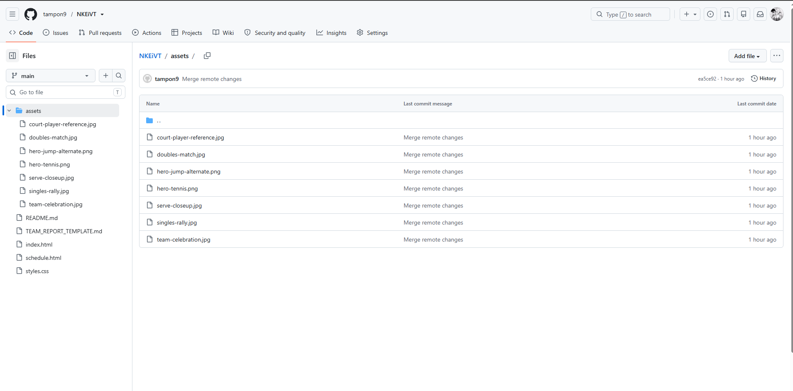
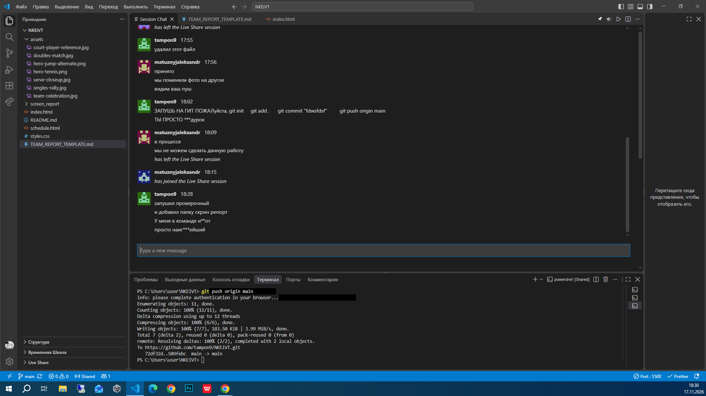
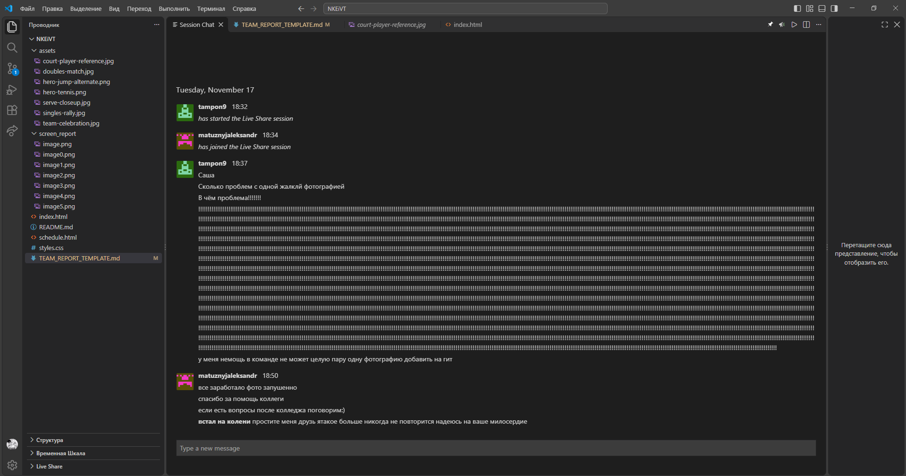
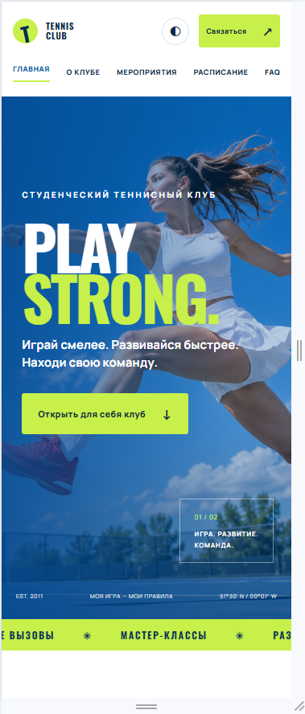
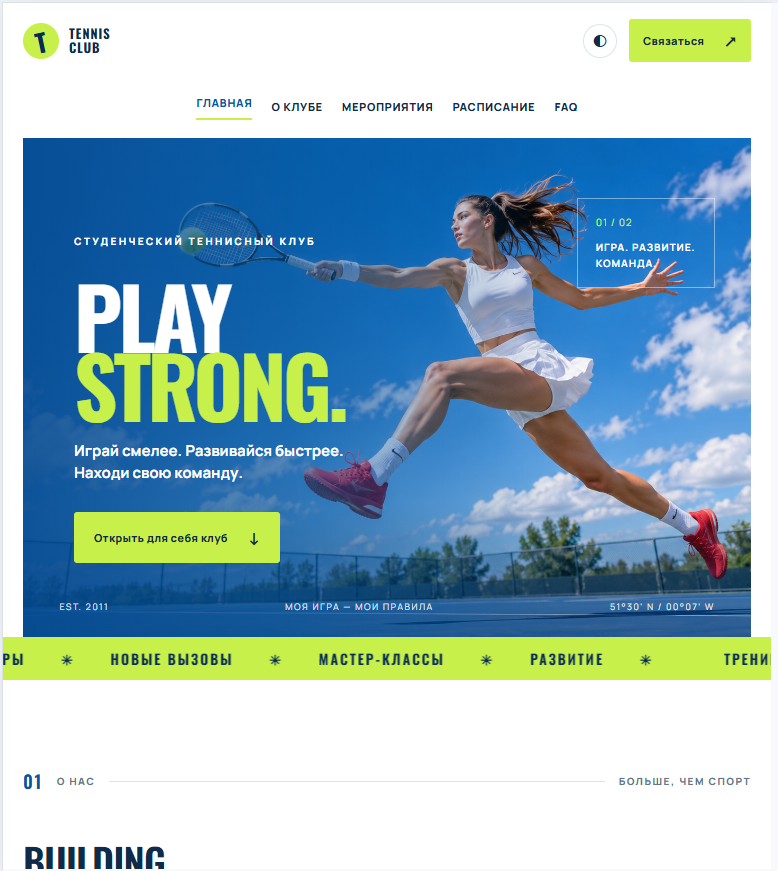
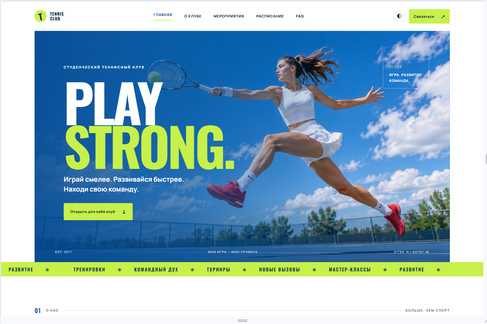
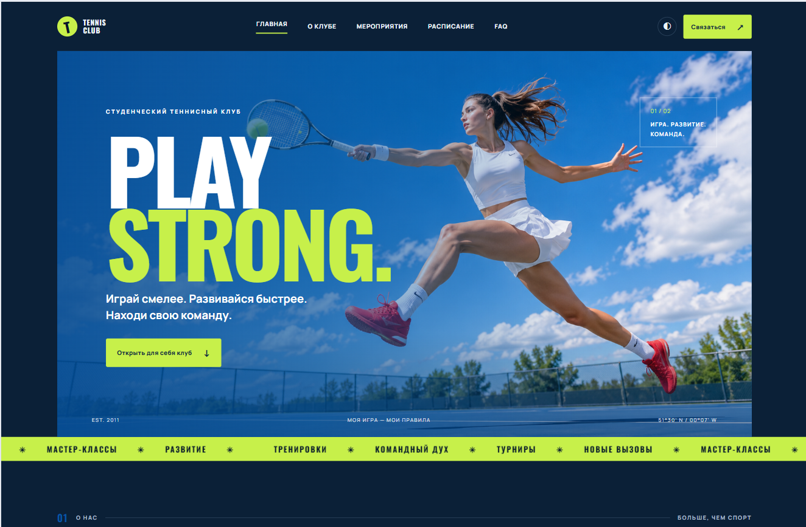
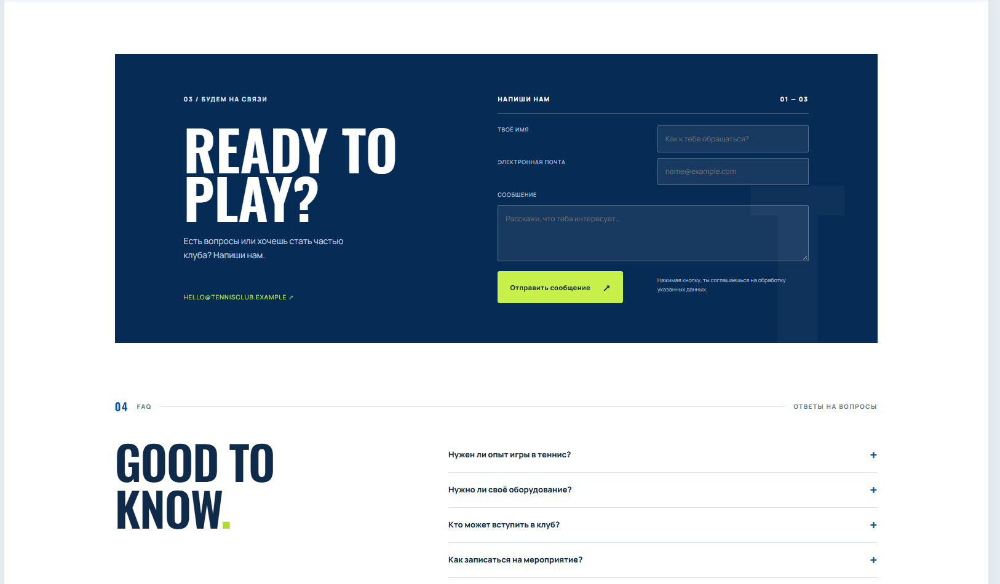

# Отчёт о совместной разработке (шаблон)

**Проект:** TENNIS CLUB — студенческий теннисный клуб  
**Участники:** Никита, Александра, Максим, Александр

## Распределение вклада

- **Никита:** семантическая HTML-структура, навигация, доступность, README.
- **Александра:** контент страниц, карточки событий, форма, FAQ и alt-тексты.
- **Максим:** CSS-дизайн, переменные, адаптивная сетка, типографика и состояния интерфейса.
- **Александр:** CSS-фильтрация, модальные окна, аккордеон и проверка адаптивности.

## Сессии VS Live Share — заполнить по факту

| № | Дата и время | Участники | Что делали | Длительность | Доказательство |
|---|---|---|---|---|---|
| 1 | 16:23 - 17:35  | Вся команда | Планирование и каркас страниц | 30+ минут |  |
| 2 | 18:01 - 18:31 | Вся команда | Параллельная разработка и follow-review | 30+ минут |  |
| 3 | 18:33 - 18:55 | Вся команда | Общий терминал, общий сервер, тестирование | 30+ минут |  |

## Трудности и решения

Заполнить после командной проверки: было выявленно множество недочётов в реализации сайта. Также трудности с коммуникацией. Обнаружить проблему легко, но исправить её намного сложнее. И часть команды когда не может справиться с поставленной задачей очень долгое время не сообщает об этом, из-за этого затягивает сроки выполнения.

## Проверка

360 px: , 768 px:  и 1440 px: , , 
